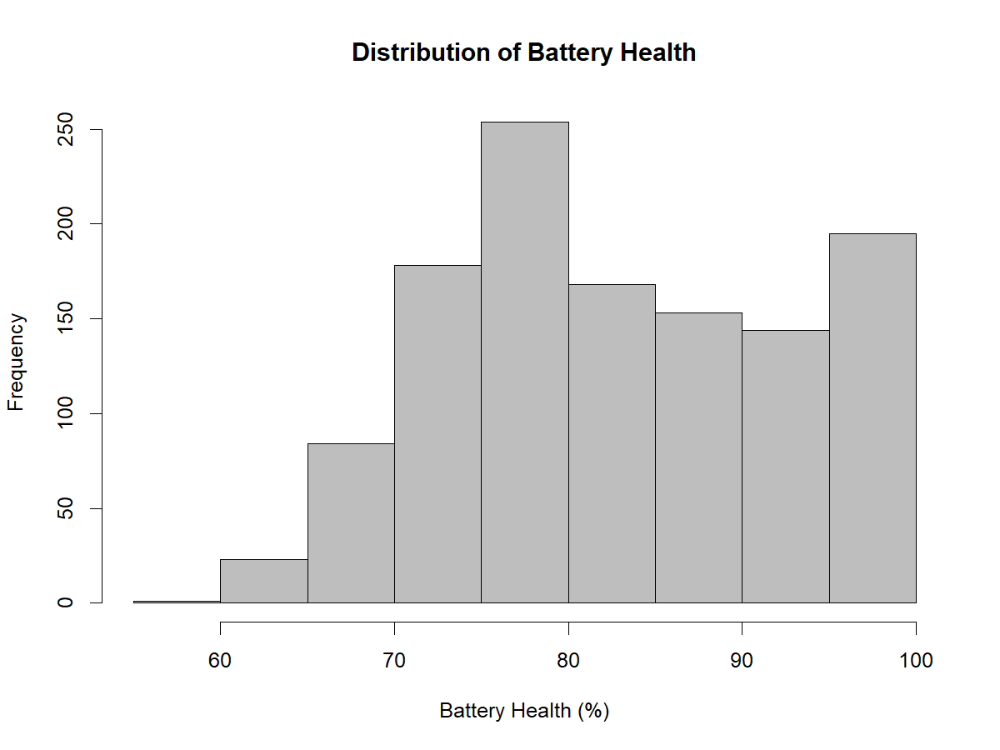
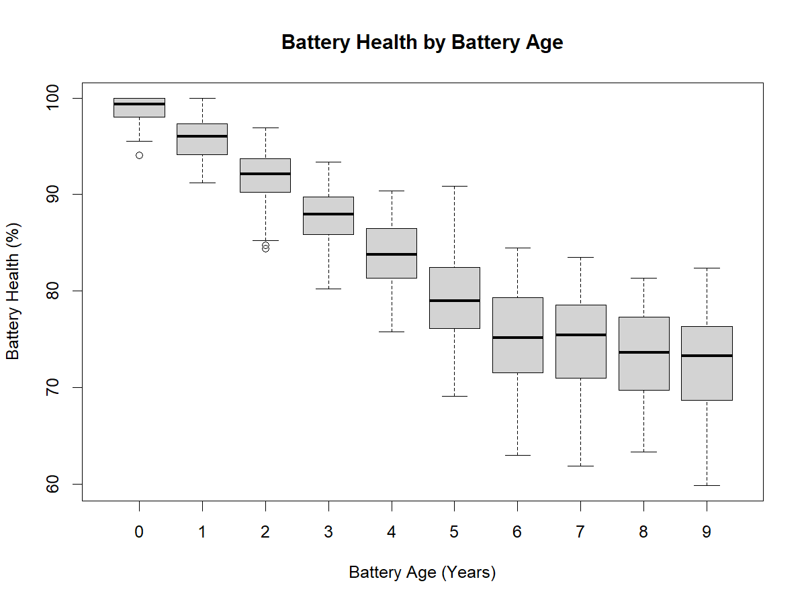
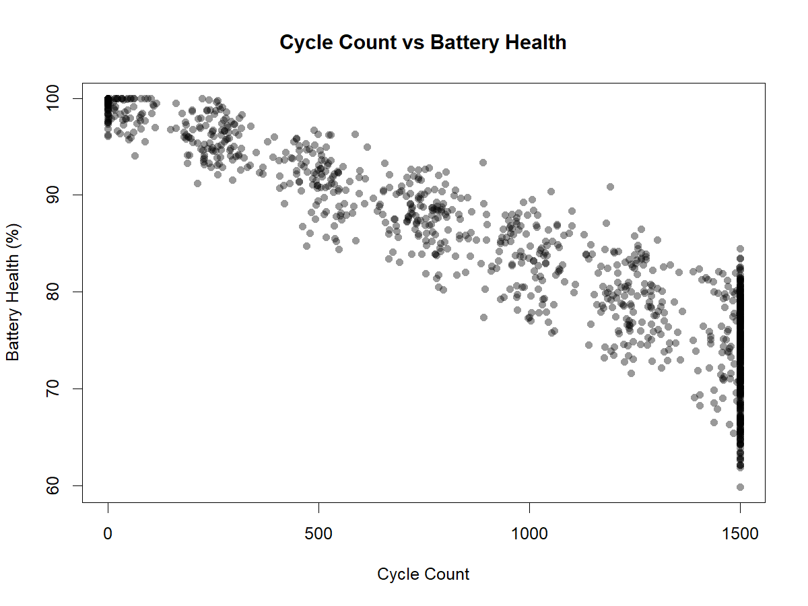
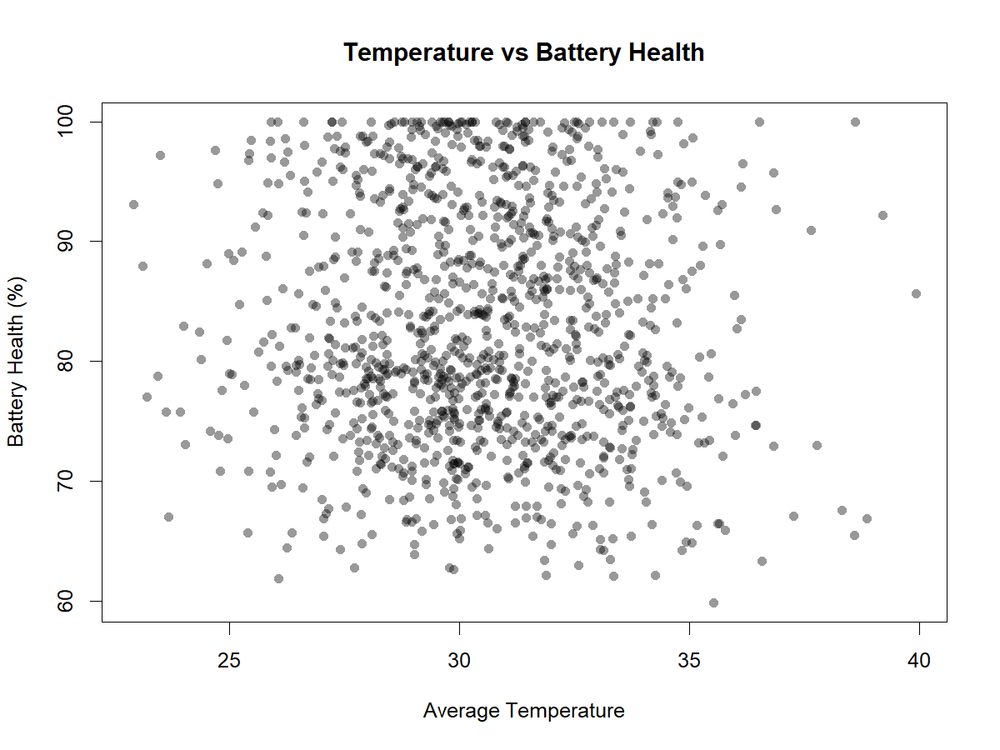
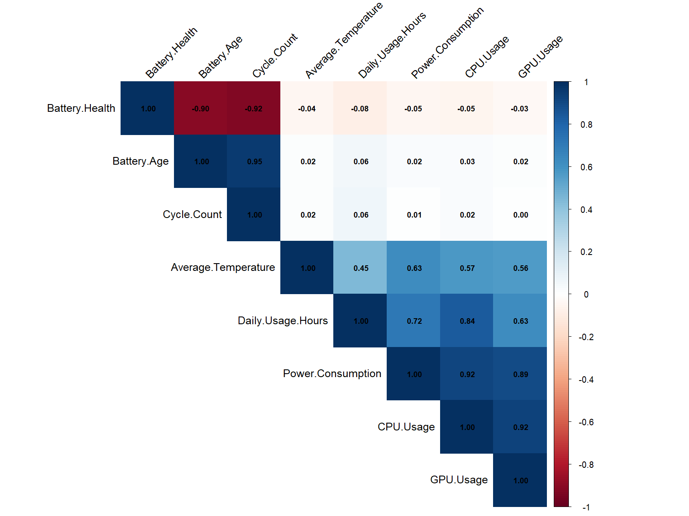
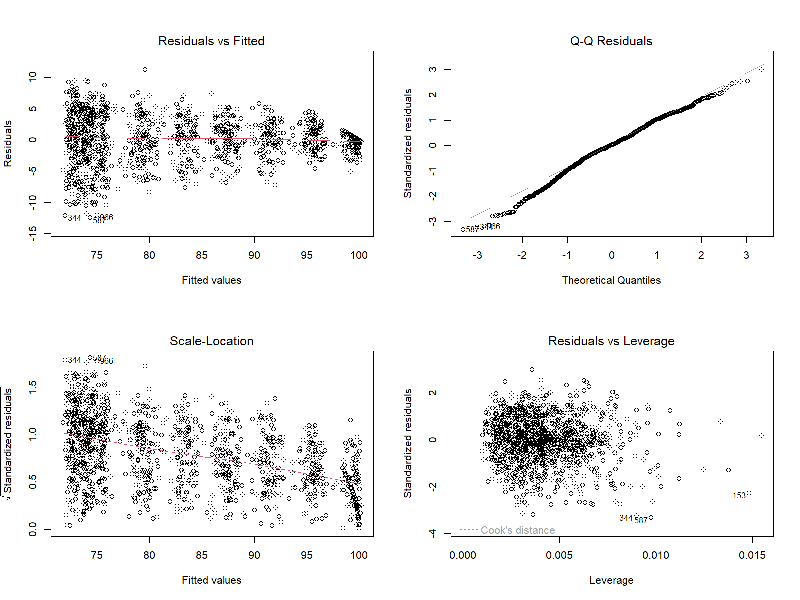
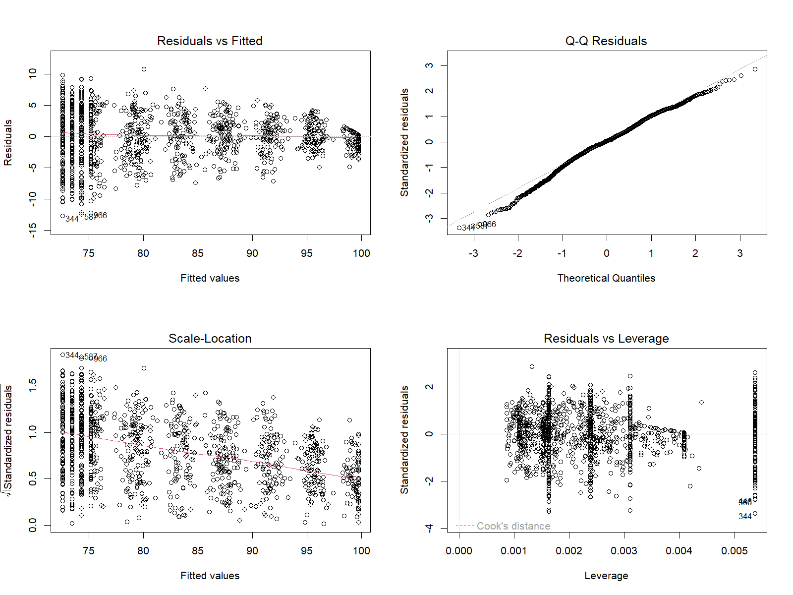

# Laptop Battery Health Statistical Analysis

Exploratory data analysis, hypothesis testing, and regression modelling of laptop battery health using R.

This project investigates the statistical relationships between battery health and laptop usage characteristics, evaluates multiple linear regression models, and compares their predictive performance to identify whether simpler models can achieve comparable accuracy.

## Project Overview

Laptop battery health can be influenced by ageing, charging cycles, usage patterns, and operating conditions. Understanding these relationships provides an opportunity to explore statistical methods for identifying important predictors and evaluating regression models.

Using a publicly available synthetic dataset containing 1,200 observations, this project applies:

- Exploratory Data Analysis (EDA)
- Descriptive Statistics and Data Visualisation
- Pearson Correlation and Hypothesis Testing
- Multiple Linear Regression
- Regression Diagnostics and Multicollinearity Assessment
- Model Selection using Adjusted R², AIC, and BIC
- Predictive Evaluation using RMSE and MAE

**Objective:** Examine the associations between battery health and selected predictors, then determine whether reduced regression models can achieve similar predictive performance to the full model.

## Dataset

**Source:** [Laptop Battery Health Prediction Dataset — Kaggle](https://www.kaggle.com/datasets/dharmendrapandit12/laptop-battery-health-dataset)

The dataset contains:

- **1,200 observations**
- **11 variables**
- **0 missing values**
- **0 duplicate records**

**Target Variable:**
- Battery Health (%)

**Selected Predictors:**
- Battery Age
- Cycle Count
- Daily Usage Hours
- Average Temperature

Full Charge Capacity and Design Capacity were excluded from regression modelling because preliminary analysis suggested that Battery Health was approximately derived from their ratio. Including these variables could introduce target leakage and artificially inflate predictive performance.

The dataset is synthetic and is used to demonstrate statistical analysis techniques rather than to validate real-world laptop battery degradation patterns.

For dataset details and download instructions, see [data/README.md](data/README.md).

## Repository Structure

```text
laptop-battery-health-statistical-analysis/
│
├── README.md
├── .gitignore
│
├── data/
│   ├── README.md
│   └── LaptopBatteryHealthPrediction.csv
│
├── scripts/
│   ├── 01_exploratory_analysis.R
│   └── 02_statistical_modelling.R
│
├── figures/
│   ├── battery_health_distribution.png
│   ├── battery_age_boxplot.png
│   ├── cycle_count_vs_battery_health.png
│   ├── temperature_vs_battery_health.png
│   ├── correlation_heatmap.png
│   ├── full_model_diagnostics.png
│   └── age_cycle_model_diagnostics.png
│
└── results/
    ├── descriptive_statistics.csv
    ├── correlation_matrix.csv
    ├── correlation_results.csv
    ├── regression_coefficients.csv
    ├── model_comparison.csv
    ├── full_model_summary.txt
    ├── full_model_vif.txt
    ├── age_cycle_model_vif.txt
    └── session_info.txt
```

The project is organised into two reproducible R scripts. The first handles exploratory analysis and visualisation, while the second performs statistical testing, regression modelling, diagnostics, and model evaluation.

The `figures/` and `results/` directories contain outputs generated by these scripts.

## Methodology

### 1. Data Exploration and Preparation

The dataset was imported into R and examined for structural and data-quality issues.

The analysis included:

- Inspecting data types and dataset dimensions
- Checking missing values and duplicate observations
- Calculating descriptive statistics
- Examining distributions and relationships using visualisations
- Calculating a correlation matrix

No missing values or duplicate records were identified.

### 2. Exploratory Data Analysis

Descriptive statistics were calculated for Battery Health and the four selected predictors.

| Variable | Mean | Standard Deviation |
|---|---:|---:|
| Battery Health | 82.94 | 9.92 |
| Battery Age | 4.57 | 2.83 |
| Cycle Count | 993.81 | 527.25 |
| Daily Usage Hours | 6.44 | 3.15 |
| Average Temperature | 30.48 | 2.62 |

Visualisations were generated to examine the distribution of Battery Health and its relationships with Battery Age, Cycle Count, and Average Temperature.

#### Battery Health Distribution



#### Battery Health by Battery Age



#### Cycle Count vs Battery Health



#### Average Temperature vs Battery Health



#### Correlation Heatmap



The exploratory analysis indicated strong negative associations between Battery Health and both Battery Age and Cycle Count.

### 3. Pearson Correlation and Hypothesis Testing

Pearson correlation tests were performed to examine the linear relationships between Battery Health and each selected predictor.

| Predictor | Pearson r | p-value | Interpretation |
|---|---:|---:|---|
| Battery Age | -0.901 | <0.001 | Strong negative correlation |
| Cycle Count | -0.921 | <0.001 | Strong negative correlation |
| Daily Usage Hours | -0.084 | 0.003 | Very weak negative correlation |
| Average Temperature | -0.041 | 0.154 | Very weak, non-significant correlation |

**Key observations:**

- Battery Age and Cycle Count exhibited strong negative correlations with Battery Health.
- Daily Usage Hours showed a statistically significant but very weak association, demonstrating that statistical significance does not necessarily imply practical importance.
- Average Temperature did not demonstrate a statistically significant linear relationship with Battery Health.

These correlations describe statistical associations and do not establish causation.

### 4. Multiple Linear Regression

An initial multiple linear regression model was fitted using four predictors:

- Battery Age
- Cycle Count
- Daily Usage Hours
- Average Temperature

The full model achieved:

- **R²:** 0.8558
- **Adjusted R²:** 0.8554
- **Residual Standard Error:** 3.774

The model explained approximately 85.6% of the observed variation in Battery Health.

#### Regression Coefficients

| Predictor | Estimate | p-value |
|---|---:|---:|
| Intercept | 102.100 | <0.001 |
| Battery Age | -0.875 | <0.001 |
| Cycle Count | -0.01284 | <0.001 |
| Daily Usage Hours | -0.0599 | 0.123 |
| Average Temperature | -0.0647 | 0.165 |

Battery Age and Cycle Count remained statistically significant predictors after controlling for the other variables.

Daily Usage Hours and Average Temperature were not statistically significant in the full regression model.

### 5. Regression Diagnostics and Multicollinearity

Regression diagnostic plots were examined to assess model assumptions, including:

- Linearity
- Residual distribution
- Constant error variance
- Influential observations



The diagnostics suggested potential heteroscedasticity and departures from normality in the residual distribution tails.

Variance Inflation Factors (VIF) were calculated to assess multicollinearity.

Battery Age and Cycle Count had VIF values of approximately **10.72**, indicating substantial multicollinearity.

This limits the reliability of interpreting their individual regression coefficients independently.

The reduced Age + Cycle model was also examined using regression diagnostics.



### 6. Model Comparison

Four regression models were evaluated:

1. **Full Model:** Battery Age, Cycle Count, Daily Usage Hours, and Average Temperature
2. **Age + Cycle Model:** Battery Age and Cycle Count
3. **Cycle Only Model:** Cycle Count
4. **Age Only Model:** Battery Age

Model fit was compared using:

- Adjusted R²
- Akaike Information Criterion (AIC)
- Bayesian Information Criterion (BIC)

Predictive performance was evaluated using:

- Root Mean Squared Error (RMSE)
- Mean Absolute Error (MAE)

An **80/20 random train-test split** was used, with random seed `123` for reproducibility.

The training set contained 960 observations, while the test set contained 240 observations.

#### Model Comparison Results

| Model | Adjusted R² | AIC | BIC | Test RMSE | Test MAE |
|---|---:|---:|---:|---:|---:|
| Full Model | 0.8554 | 6600.23 | 6630.77 | 3.750 | 2.953 |
| **Age + Cycle** | **0.8547** | 6604.06 | 6624.42 | **3.734** | **2.923** |
| Cycle Only | 0.8490 | 6649.28 | 6664.55 | 3.787 | 2.944 |
| Age Only | 0.8111 | 6917.33 | 6932.60 | 4.341 | 3.416 |

**Note:** Adjusted R², AIC, and BIC were calculated from models fitted to the full dataset. Test RMSE and MAE were calculated using predictions from models trained on the 80% training subset and evaluated on the held-out 20% test subset.

RMSE and MAE are expressed in battery-health percentage points.

#### Model Selection Findings

The **Age + Cycle model** achieved the lowest test RMSE and MAE, marginally outperforming the full model despite using fewer predictors.

The **Cycle Only model** produced comparable predictive performance while requiring only one predictor. It also avoids the multicollinearity associated with including both Battery Age and Cycle Count.

Although the full model achieved the highest adjusted R² and lowest AIC, the reduced models demonstrated that similar predictive accuracy could be achieved with fewer variables.

The small differences in test performance should be interpreted cautiously because the evaluation used a single random train-test split.

## Key Findings

1. **Battery Age and Cycle Count were the strongest predictors associated with Battery Health.** Both exhibited strong negative correlations with the target variable.

2. **Daily Usage Hours and Average Temperature provided limited additional predictive value.** Neither variable was statistically significant after controlling for Battery Age and Cycle Count in the full regression model.

3. **Multicollinearity affected the interpretation of regression coefficients.** Battery Age and Cycle Count were highly correlated, producing elevated VIF values.

4. **Simpler regression models achieved comparable predictive performance.** The Age + Cycle model obtained the lowest test errors, while the Cycle Only model offered a simpler alternative.

5. **Model evaluation requires more than goodness-of-fit statistics.** Predictive error, model complexity, multicollinearity, and regression assumptions all contributed to the model comparison.

## Limitations

Several limitations should be considered when interpreting the findings:

- **Synthetic dataset:** The observations may not accurately represent real-world laptop battery ageing or degradation.
- **Bounded target variable:** Battery Health is bounded between 0% and 100%, whereas ordinary linear regression does not constrain predictions to this interval.
- **Regression assumptions:** Diagnostic plots suggested potential heteroscedasticity and deviations from normality.
- **Multicollinearity:** Battery Age and Cycle Count were strongly correlated, complicating the interpretation of their individual effects.
- **Single train-test split:** Predictive performance was assessed using one random split, so small differences between models may not be stable across other samples.
- **Correlation versus causation:** Statistical relationships identified in this analysis should not be interpreted as evidence of causal effects.

This project demonstrates the application of statistical methods to a synthetic dataset rather than a validated real-world battery-health prediction system.

## How to Run

### Requirements

- R
- RStudio (recommended)
- R packages: `corrplot` and `car`

### Instructions

**1. Clone the repository**

```bash
git clone https://github.com/isaacdinesh/laptop-battery-health-statistical-analysis.git
```

**2. Open the project folder**

Open the cloned repository in RStudio and set the working directory to the repository root.

**3. Verify the dataset**

The dataset is included in the repository at:

`data/LaptopBatteryHealthPrediction.csv`

No separate download is required. The original dataset and licensing information are documented in [data/README.md](data/README.md).

**4. Install the required packages**

Run the following command in the R Console:

```r
install.packages(c("corrplot", "car"))
```

**5. Run the exploratory analysis**

```r
source("scripts/01_exploratory_analysis.R")
```

This script performs data-quality checks, calculates descriptive statistics and correlations, and generates exploratory visualisations.

**6. Run the statistical modelling**

```r
source("scripts/02_statistical_modelling.R")
```

This script performs Pearson correlation tests, regression modelling, multicollinearity assessment, regression diagnostics, model comparison, and predictive evaluation.

### Generated Outputs

Running both scripts produces:

- **Figures:** Exploratory plots and regression diagnostic plots saved in `figures/`.
- **Statistical results:** Descriptive statistics, correlation results, regression coefficients, VIF values, and model comparison tables saved in `results/`.
- **Reproducibility information:** R session information saved in `results/session_info.txt`.

The model evaluation uses a fixed random seed (`123`) to reproduce the train-test split.

## Tools and Technologies

- **R:** Statistical analysis and regression modelling
- **RStudio:** Development environment
- **Base R:** Data exploration, hypothesis testing, linear regression, model comparison, and predictive evaluation
- **corrplot:** Correlation matrix visualisation
- **car:** Variance Inflation Factor (VIF) analysis

## Data Source and References

1. [Laptop Battery Health Prediction Dataset — Kaggle](https://www.kaggle.com/datasets/dharmendrapandit12/laptop-battery-health-dataset)
2. Vetter et al. (2005). [Ageing mechanisms in lithium-ion batteries](https://doi.org/10.1016/j.jpowsour.2005.01.006)
3. Tredennick et al. (2021). [A practical guide to selecting models for exploration, inference, and prediction in ecology](https://doi.org/10.1002/ecy.3336)

## Project Context

Developed as part of the **Statistical Methods for Data Science** module in a Master of Data Science programme.

The original coursework analyses have been consolidated into two organised, reproducible R scripts for portfolio presentation.
